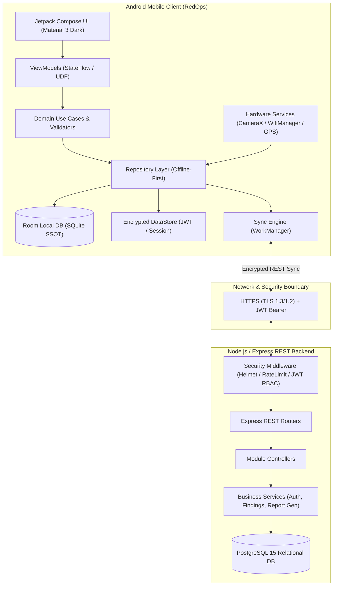
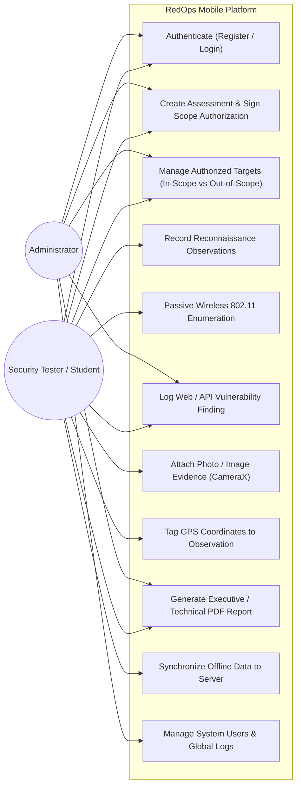
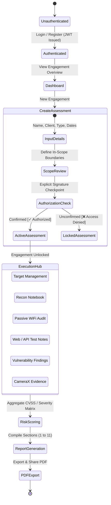
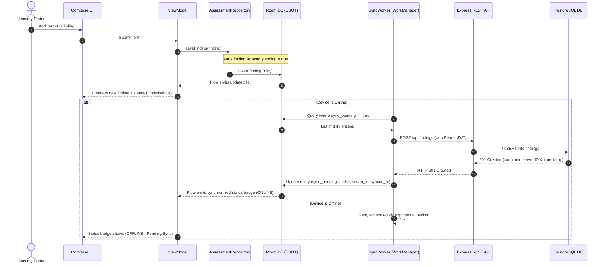
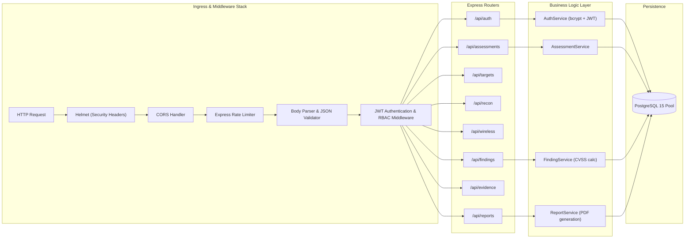

# RedOps Mobile — System Architecture & Technical Design

## 1. Executive Architectural Overview

**RedOps Mobile** ("Authorized Security Assessment Platform") is an enterprise-grade mobile application and supporting REST API backend designed for managing authorized penetration testing, vulnerability assessments, and defensive audits.

The application adheres to **Clean Architecture** principles and the **Model-View-ViewModel (MVVM)** pattern on Android, backed by an offline-first data model utilizing **Jetpack Room** as the Single Source of Truth (SSOT) and **WorkManager** for asynchronous data synchronization with a Node.js/Express REST backend.

---

## 2. High-Level System Architecture

The overall system comprises three primary tiers:
1. **Android Client Tier**: Native Kotlin application utilizing Jetpack Compose, Material 3, Room, Retrofit, CameraX, and hardware sensors.
2. **Gateway & API Tier**: Node.js / Express REST API serving authenticated endpoints over TLS with JWT validation, role-based authorization, and rate limiting.
3. **Storage Tier**: Dual-layer architecture:
   - Local: SQLite via Android Jetpack Room for full offline autonomy.
   - Remote: PostgreSQL 15 relational database for multi-user collaboration and persistence.



---

## 3. Mobile Client Architecture (Clean Architecture + MVVM)

The Android application implements a strict four-layer Clean Architecture model:

```mermaid
graph TD
    subgraph PresentationLayer["Presentation Layer (app/ui)"]
        Screens["Compose Screens (Dashboard, Scope, Recon, Findings, Reports)"]
        Components["M3 Custom Components (SeverityBadges, TargetCards, StatWidgets)"]
        Nav["Navigation Graph (Compose Navigation)"]
        ViewModels["ViewModels (StateFlow<UiState>, UiEvent)"]
        
        Screens --> ViewModels
        Components --> Screens
        Nav --> Screens
    end

    subgraph DomainLayer["Domain Layer (app/domain)"]
        UseCases["Use Cases (e.g., ValidateScopeUseCase, LogPassiveWifiUseCase, CreateFindingUseCase)"]
        DomainModels["Pure Domain Entities (Assessment, Target, Finding, Evidence)"]
        RepoInterfaces["Repository Interfaces (Contracts)"]
        
        UseCases --> DomainModels
        UseCases --> RepoInterfaces
    end

    subgraph DataLayer["Data Layer (app/data)"]
        RepoImpl["Repository Implementations"]
        LocalData["Local Data Source (Room Database & DAOs)"]
        RemoteData["Remote Data Source (Retrofit API Service & DTOs)"]
        DataStoreSource["Jetpack DataStore (Token & Preferences)"]
        Mappers["Model Mappers (DTO <-> Entity <-> Domain)"]
        
        RepoImpl --> LocalData
        RepoImpl --> RemoteData
        RepoImpl --> DataStoreSource
        LocalData --> Mappers
        RemoteData --> Mappers
    end

    subgraph ServicesLayer["Hardware & Background Services (app/services)"]
        WifiSvc["Passive Wireless Enumerator (WifiManager BroadcastReceiver)"]
        LocationSvc["Location Service (FusedLocationProviderClient)"]
        CameraSvc["CameraX Service (ImageCapture & Storage)"]
        NotifSvc["Notification Manager & WorkManager Sync Workers"]
    end

    ViewModels --> UseCases
    RepoInterfaces <|.. RepoImpl
    ServicesLayer --> RepoImpl
```

### Layer Responsibilities

1. **Presentation Layer (`com.redops.mobile.ui`)**:
   - Built entirely in **Jetpack Compose** with Material 3.
   - Enforces a cybernetic dark-mode color system with high-contrast text and neon accents (matrix green `#00E676`, cyan `#00E5FF`, warning amber `#FFAB00`, critical red `#FF5252`).
   - Follows Uni-directional Data Flow (UDF): ViewModels expose immutable `StateFlow<T>` states and receive user `UiIntent` events.
2. **Domain Layer (`com.redops.mobile.domain`)**:
   - Zero Android framework dependencies (pure Kotlin).
   - Contains business rules, such as `ValidateScopeUseCase` which prevents adding targets or observations without explicit signed scope authorization.
3. **Data Layer (`com.redops.mobile.data`)**:
   - Implements repository interfaces defined in the domain layer.
   - Orchestrates offline-first data caching: reads always originate from Room DAOs; remote updates update Room, triggering reactive Flow emissions to ViewModels.
4. **Services Layer (`com.redops.mobile.services`)**:
   - Wraps platform-specific Android hardware APIs (CameraX, WifiManager, FusedLocationProviderClient) in coroutine-friendly abstractions.

---

## 4. Use Case Specifications



---

## 5. Application Engagement Workflow

The following state machine diagrams the mandatory progression of an authorized security assessment within RedOps Mobile:



---

## 6. Offline-First & Data Synchronization Architecture

To support field engagements in high-security air-gapped zones or basements with zero cellular coverage, RedOps Mobile operates fully offline.



### Sync State Machine
Entities in Room maintain three synchronization metadata columns:
- `sync_pending: Boolean`: `true` when created or modified locally before reaching the server.
- `server_id: String?`: UUID assigned by the PostgreSQL backend upon successful sync.
- `last_modified: Long`: Epoch timestamp used for Last-Write-Wins (LWW) conflict resolution.

---

## 7. Passive Wireless Enumeration Architecture

The wireless subsystem is strictly designed around **passive 802.11 beacon frame discovery** via standard Android operating system APIs:

```mermaid
graph TD
    subgraph AndroidOS["Android OS Framework"]
        WifiMgr["android.net.wifi.WifiManager"]
        ScanResults["List<ScanResult> (Open Airwaves)"]
        WifiReceiver["BroadcastReceiver (SCAN_RESULTS_AVAILABLE_ACTION)"]
    end

    subgraph RedOpsService["RedOps Mobile Wireless Subsystem"]
        Permissions["Permission Gatekeeper (FINE_LOCATION & NEARBY_WIFI_DEVICES)"]
        Scanner["PassiveWifiScannerImpl"]
        Parser["WifiSecurityParser (SSID, BSSID, RSSI, Frequency, Capabilities)"]
        Filter["Filter & Deduplication Engine"]
        Storage["WirelessObservationRepository"]
    end

    Permissions -->|Granted| Scanner
    Scanner -->|startScan() request| WifiMgr
    WifiMgr -->|Broadcast| WifiReceiver
    WifiReceiver -->|getScanResults()| ScanResults
    ScanResults --> Parser
    Parser --> Filter
    Filter --> Storage
```

### Safety and Compliance Guardrails:
1. **No Raw Sockets or Monitor Mode**: Operates within non-rooted Android sandbox.
2. **No Deauthentication Frames**: No transmission of 802.11 management frames.
3. **Strictly Read-Only**: Extracts metadata only (SSID, BSSID, Signal dBm, Bandwidth, WPA2/WPA3 capabilities).

---

## 8. Backend REST API Architecture

The backend is structured as a modular Express.js application designed to scale:



---

## 9. Modular Directory Structure

```
RedOps-Mobile/
├── android/
│   ├── app/
│   │   ├── src/main/
│   │   │   ├── AndroidManifest.xml
│   │   │   ├── java/com/redops/mobile/
│   │   │   │   ├── MainActivity.kt
│   │   │   │   ├── RedOpsApplication.kt
│   │   │   │   ├── data/
│   │   │   │   │   ├── local/
│   │   │   │   │   │   ├── RedOpsDatabase.kt
│   │   │   │   │   │   ├── dao/
│   │   │   │   │   │   └── entity/
│   │   │   │   │   ├── remote/
│   │   │   │   │   │   ├── RedOpsApiService.kt
│   │   │   │   │   │   ├── AuthInterceptor.kt
│   │   │   │   │   │   └── dto/
│   │   │   │   │   ├── repository/
│   │   │   │   │   └── preferences/
│   │   │   │   ├── domain/
│   │   │   │   │   ├── model/
│   │   │   │   │   ├── repository/
│   │   │   │   │   └── usecase/
│   │   │   │   ├── ui/
│   │   │   │   │   ├── navigation/
│   │   │   │   │   ├── theme/
│   │   │   │   │   ├── components/
│   │   │   │   │   └── screens/
│   │   │   │   ├── services/
│   │   │   │   │   ├── wireless/
│   │   │   │   │   ├── location/
│   │   │   │   │   ├── camera/
│   │   │   │   │   └── sync/
│   │   │   │   └── utils/
│   │   │   └── res/
│   │   └── build.gradle.kts
│   ├── build.gradle.kts
│   └── settings.gradle.kts
├── backend/
│   ├── src/
│   │   ├── server.js
│   │   ├── config/
│   │   ├── controllers/
│   │   ├── middleware/
│   │   ├── models/
│   │   ├── routes/
│   │   ├── services/
│   │   ├── database/
│   │   └── utils/
│   ├── tests/
│   ├── package.json
│   └── Dockerfile
├── database/
│   ├── schema.sql
│   └── seeds/
├── docs/
│   ├── architecture.md
│   ├── database.md
│   ├── api.md
│   ├── security.md
│   ├── wireless-enumeration.md
│   ├── testing.md
│   └── deployment.md
├── docker-compose.yml
└── README.md
```

This concludes the architectural specifications for **Phase 1**.
