# RedOps Mobile — Database Schema & Data Models

## 1. Entity-Relationship Overview

RedOps Mobile employs a unified relational model across both its **Android Room Database** (offline local store) and its **PostgreSQL 15** server database.

```mermaid
erDiagram
    USERS ||--o{ ASSESSMENTS : manages
    ASSESSMENTS ||--o{ TARGETS : includes
    ASSESSMENTS ||--o{ RECON_OBSERVATIONS : contains
    ASSESSMENTS ||--o{ NETWORK_OBSERVATIONS : logs
    ASSESSMENTS ||--o{ WIRELESS_OBSERVATIONS : captures
    ASSESSMENTS ||--o{ WEB_TESTS : executes
    ASSESSMENTS ||--o{ FINDINGS : discovers
    ASSESSMENTS ||--o{ REPORTS : generates
    ASSESSMENTS ||--o{ TASKS : schedules
    FINDINGS ||--o{ EVIDENCE : substantiates

    USERS {
        uuid id PK
        string full_name
        string username UK
        string email UK
        string password_hash
        string role "USER | ADMIN"
        timestamp created_at
    }

    ASSESSMENTS {
        uuid id PK
        uuid user_id FK
        string name
        string client
        text description
        date start_date
        date end_date
        string assessment_type "Web | API | Network | Wireless | Internal | External | Other"
        boolean is_authorized "Explicit consent flag"
        text scope_notes
        string status "ACTIVE | COMPLETED | ARCHIVED"
        boolean is_demo "Demo mode flag"
        timestamp created_at
        timestamp updated_at
    }

    TARGETS {
        uuid id PK
        uuid assessment_id FK
        string domain
        string ip_address
        string hostname
        string url
        text description
        string scope_status "IN_SCOPE | OUT_OF_SCOPE"
        text notes
        timestamp created_at
    }

    RECON_OBSERVATIONS {
        uuid id PK
        uuid assessment_id FK
        string observation_type "DOMAIN | SUBDOMAIN | IP | PORT | TECH | SERVER | FRAMEWORK | ENDPOINT | DNS"
        string value
        text notes
        timestamp created_at
    }

    NETWORK_OBSERVATIONS {
        uuid id PK
        uuid assessment_id FK
        string host
        string ip_address
        int port
        string protocol "TCP | UDP"
        string service
        string version
        text notes
        timestamp created_at
    }

    WIRELESS_OBSERVATIONS {
        uuid id PK
        uuid assessment_id FK
        string ssid
        string bssid
        int frequency
        int channel
        int signal_dbm
        string security_capability "OPEN | WPA2 | WPA3 | EAP"
        string wifi_standard
        double latitude
        double longitude
        text notes
        timestamp observed_at
    }

    WEB_TESTS {
        uuid id PK
        uuid assessment_id FK
        string test_name
        string category "Auth | Authz | InputVal | Session | Headers | APISec | AccessControl | Config | Other"
        string target_url
        string http_method "GET | POST | PUT | DELETE | PATCH"
        text observation
        string result "PASS | FAIL | INCONCLUSIVE"
        text notes
        timestamp created_at
    }

    FINDINGS {
        uuid id PK
        uuid assessment_id FK
        string custom_id "F-001"
        string title
        text description
        string severity "INFO | LOW | MEDIUM | HIGH | CRITICAL"
        string affected_asset
        text impact
        text remediation
        text references
        string status "OPEN | CONFIRMED | REMEDIATED | ACCEPTED | FALSE_POSITIVE"
        timestamp created_at
        timestamp updated_at
    }

    EVIDENCE {
        uuid id PK
        uuid finding_id FK
        string file_path
        string file_type "IMAGE | SCREENSHOT | TEXT | LOG"
        text description
        double latitude
        double longitude
        timestamp created_at
    }

    REPORTS {
        uuid id PK
        uuid assessment_id FK
        string title
        text executive_summary
        text methodology
        text risk_summary
        text recommendations
        text conclusion
        string pdf_path
        timestamp generated_at
    }

    TASKS {
        uuid id PK
        uuid assessment_id FK
        string title
        timestamp due_date
        string priority "LOW | MEDIUM | HIGH"
        boolean is_completed
    }
```

---

## 2. Room vs PostgreSQL Synchronization Strategy

Both databases share the same logical schema and field naming conventions.

In Room:
- Each table includes sync metadata columns: `sync_status` (enum: `SYNCED`, `DIRTY`, `PENDING_DELETE`), `server_id` (nullable UUID), and `last_updated_at` (epoch timestamp).
- Primary keys on Android are local UUID strings generated at insertion (`UUID.randomUUID().toString()`), guaranteeing zero ID collisions upon remote sync.
