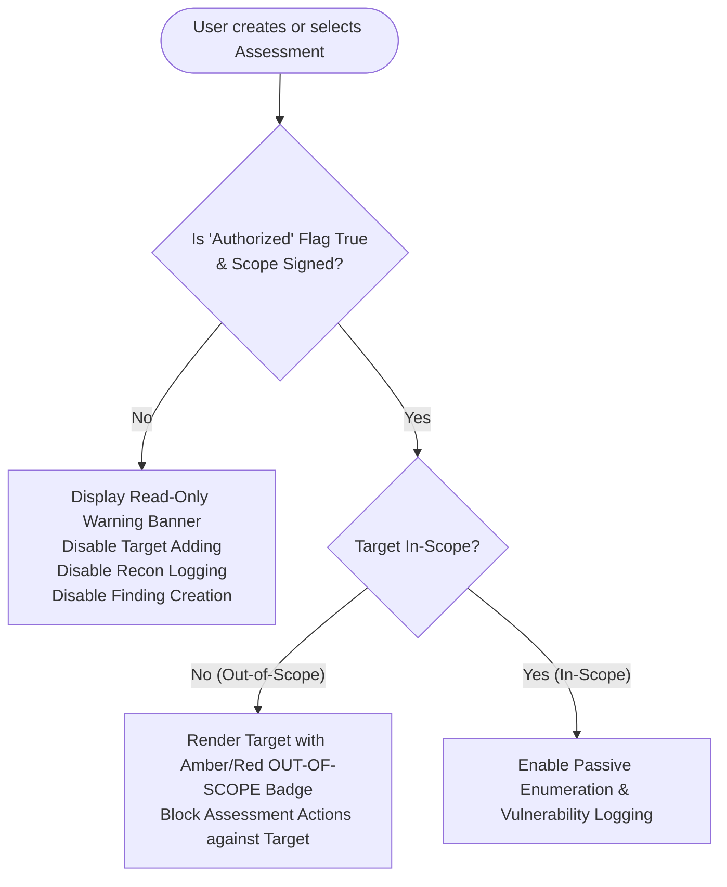

# RedOps Mobile — Security & Ethics Architecture

## 1. Ethical Assessment Policy & Legal Framework

RedOps Mobile is built explicitly to support **authorized penetration tests, academic cybersecurity lab exercises, and defensive vulnerability assessments**.

### 1.1 Strict Legal Boundary
Testing computer systems, web applications, APIs, or wireless networks without explicit, written permission from the asset owner is a federal crime in many jurisdictions (e.g., Computer Fraud and Abuse Act [CFAA] in the United States, Computer Misuse Act in the UK) and violates international cyber laws.

```
+---------------------------------------------------------------------------------+
|                                 ETHICAL NOTICE                                  |
|                                                                                 |
| RedOps Mobile is an audit documentation and passive reconnaissance platform.    |
| It does NOT contain offensive weaponization, deauthentication, exploit delivery, |
| password cracking, or automated intrusion functionality.                        |
+---------------------------------------------------------------------------------+
```

---

## 2. In-App Scope & Authorization Checkpoint System

To prevent accidental or unauthorized testing, RedOps Mobile enforces programmatic safeguards:



### Technical Implementation:
- **Domain Gate**: Every UseCase in `com.redops.mobile.domain.usecase` (e.g. `CreateFindingUseCase`, `AddTargetUseCase`) inspects the parent assessment's `isAuthorized` boolean property.
- If `isAuthorized == false`, a `SecurityScopeException("Assessment lacks signed authorization declaration")` is thrown.
- **UI Indication**: The Compose UI displays a prominent banner:
  > *"Use only on systems and networks for which you have explicit authorization. Authorized use only."*

---

## 3. Passive Wireless Enumeration Constraints

The wireless auditing module is strictly **passive** and operates using official Android OS public APIs:

| Permitted Operations (Passive) | Prohibited Operations (Offensive) |
|---|---|
| Scan broadcasted 802.11 beacon frames via `WifiManager` | Sending 802.11 deauthentication frames |
| Read SSID, BSSID, RSSI (signal strength) | Capturing WPA/WPA2 4-way handshakes |
| Detect frequency band (2.4 GHz, 5 GHz, 6 GHz) | Offline dictionary or brute-force cracking |
| Read security capability flags (OPEN, WEP, WPA2-PSK, WPA3-SAE, EAP) | Rogue Access Point / Evil Twin broadcast |
| Associate observation with authorized assessment notes | Packet injection / raw monitor mode socket creation |

### Android Permission Model
In compliance with Android 13+ (API 33+) privacy enhancements:
- Uses `android.permission.NEARBY_WIFI_DEVICES` (with `android:usesPermissionFlags="neverForLocation"` where applicable).
- Requests `ACCESS_FINE_LOCATION` only when the user explicitly enables geocoding / GPS tagging for the wireless site survey.
- Clear disclosure dialogs explain why location permission is requested before prompting the system dialog.

---

## 4. Mobile Client Data Protection & Secrets Handling

### 4.1 Token Storage
- Authentication tokens (JWT access and refresh tokens) are **never** stored in plain-text `SharedPreferences`.
- Stored using **Jetpack Security EncryptedSharedPreferences** or **Jetpack DataStore backed by Tink** (AES-256-GCM encryption with keys residing in hardware-backed **Android Keystore**).

### 4.2 Local Database Security
- Room Database SQLite file is protected by Android's internal application sandbox (`/data/data/com.redops.mobile/databases/`).
- Room database is architected with hooks for **SQLCipher** for hardware-assisted database encryption at rest.

### 4.3 Network Security Configuration
- The Android client enforces **HTTPS (TLS 1.2/1.3)** for all communication with the backend.
- Clear-text HTTP traffic is disabled in `network_security_config.xml`:
  ```xml
  <network-security-config>
      <base-config cleartextTrafficPermitted="false">
          <trust-anchors>
              <certificates src="system" />
          </trust-anchors>
      </base-config>
  </network-security-config>
  ```
- Local emulator development uses explicit loopback exceptions (`10.0.2.2`).

---

## 5. Backend REST API Security Controls

### 5.1 Authentication & Passwords
- **Algorithm**: `bcryptjs` with a work factor of 12 rounds for password hashing. Plain-text passwords are never logged, stored, or emitted.
- **Tokens**: JWT signed with HMAC-SHA256 (`HS256`) or RSA-256 (`RS256`).
- **Token Expiration**: Access tokens expire in 15 minutes; refresh tokens expire in 7 days and are rotated on each use.

### 5.2 Input Validation & Injection Prevention
- All incoming request payloads are strictly validated against pre-compiled schemas before passing to controllers.
- Relational database queries use **parameterized queries** via PostgreSQL driver (`$1, $2, ...`) or ORM, eliminating SQL Injection (SQLi).

### 5.3 Ingress Hardening
- **Helmet.js**: Sets security HTTP headers (`Content-Security-Policy`, `X-Frame-Options`, `X-Content-Type-Options`, `Strict-Transport-Security`).
- **CORS**: Explicit whitelist of allowed origins; wildcard `*` disallowed in production.
- **Rate Limiting**: `express-rate-limit` prevents brute-force login attempts (5 requests per 15 minutes on `/api/auth/login`).
- **File Upload Protection**: Multer configured with strict MIME-type whitelists (JPEG, PNG, WebP only) and file size quotas (maximum 10 MB per evidence upload). Uploaded files are stripped of executable attributes and given randomized UUID filenames.
