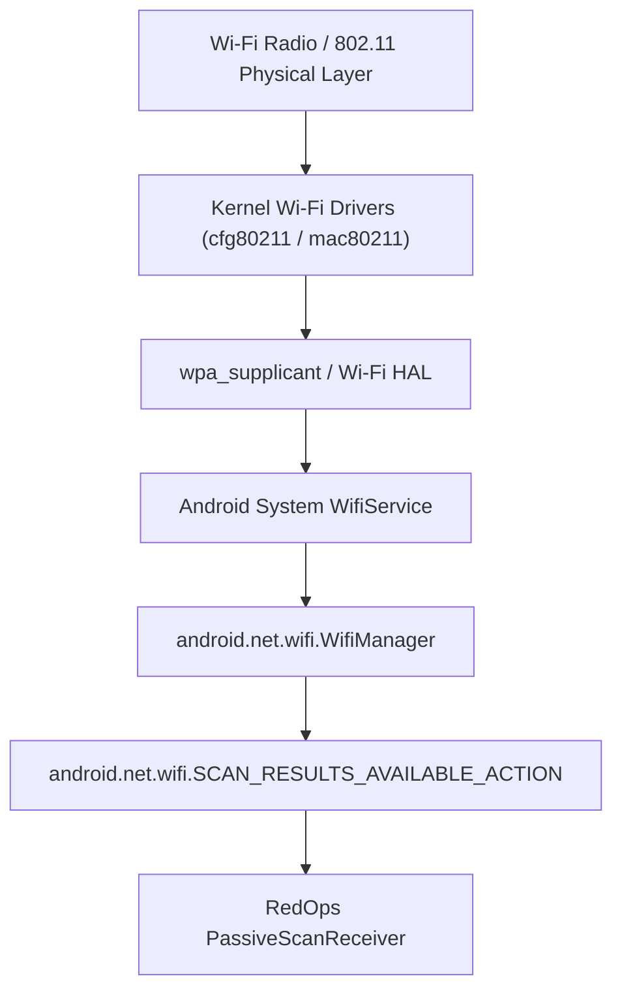

# RedOps Mobile — Wireless Enumeration Technical Architecture

## 1. Safety Mandate & Ethical Stance

Wireless cybersecurity assessments present significant legal and regulatory sensitivity. RedOps Mobile enforces a **strict passive enumeration architecture**.

```
+---------------------------------------------------------------------------------+
|                               PASSIVE AUDIT ONLY                                |
|                                                                                 |
| RedOps Mobile performs ONLY passive listening of standard 802.11 beacon         |
| frames broadcasted in public space by Wi-Fi access points.                     |
|                                                                                 |
| PROHIBITED ACTIONS:                                                             |
| - Deauthentication frame transmission (802.11 type 0000 subtype 1100)           |
| - WPA/WPA2/WPA3 4-way handshake sniffing or dictionary cracking                |
| - Rogue AP or Evil Twin generation                                              |
| - Packet injection or RF jamming                                                |
+---------------------------------------------------------------------------------+
```

---

## 2. Android 802.11 Architecture & API Integration

### 2.1 Android Wi-Fi Stack Layers
On non-rooted modern Android devices (Android 10 through 14+), hardware access is governed by the Android Wi-Fi HAL and `WifiManager`.



### 2.2 Permissions Required
- Android 13+ (API level 33+):
  - `android.permission.NEARBY_WIFI_DEVICES` with `android:usesPermissionFlags="neverForLocation"` (if geocoding disabled).
- Android 10-12 (API levels 29-32):
  - `android.permission.ACCESS_FINE_LOCATION` (Android requires location permission to retrieve Wi-Fi BSSIDs and SSIDs to prevent unauthorized user location tracking via Wi-Fi trilateration).
- `android.permission.ACCESS_WIFI_STATE`
- `android.permission.CHANGE_WIFI_STATE` (to trigger manual scan requests)

---

## 3. Extracted Data Points

For each detected Access Point in range, RedOps Mobile parses and visualizes:
1. **SSID** (Service Set Identifier): Network name.
2. **BSSID** (Basic Service Set Identifier): MAC address of the radio AP.
3. **RSSI** (Received Signal Strength Indicator): dBm measurement (e.g., `-45 dBm` Excellent, `-85 dBm` Weak).
4. **Channel & Frequency**: Frequency in MHz (e.g., `2412 MHz` -> Channel 1; `5180 MHz` -> Channel 36).
5. **Security Capabilities**: Parsed security string identifying:
   - `[OPEN]`: Insecure unencrypted network.
   - `[WEP]`: Deprecated, insecure legacy encryption.
   - `[WPA-PSK-CCMP]`: WPA1/WPA2 Pre-Shared Key.
   - `[WPA3-SAE]`: Modern Simultaneous Authentication of Equals.
   - `[EAP]`: Enterprise 802.1X network.
6. **Wi-Fi Standard**: 802.11b/g/n (Wi-Fi 4), 802.11ac (Wi-Fi 5), 802.11ax (Wi-Fi 6), or 802.11be (Wi-Fi 7).

---

## 4. Android Wi-Fi Throttling Considerations
Starting in Android 9 (Pie) and Android 10 (Q):
- Foreground apps are throttled to **4 scans every 2 minutes**.
- Background apps are throttled to **1 scan every 30 minutes**.
- RedOps Mobile handles this limitation gracefully by caching recent results and displaying clear UI hints:
  > *"Wi-Fi scan throttled by Android OS power management. Displaying cached results from last scan."*
